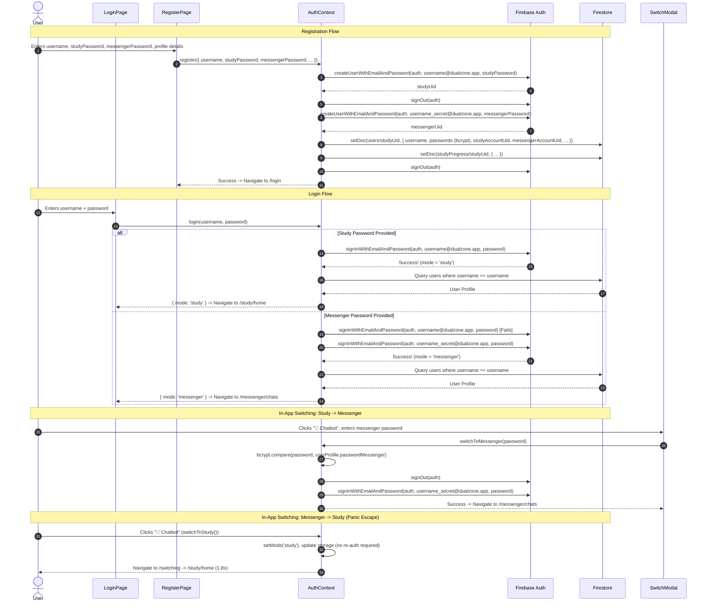
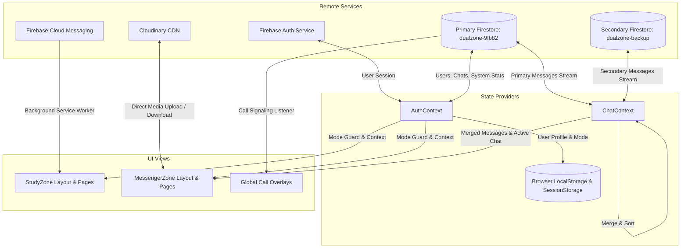

# PROJECT SUMMARY: DUALZONE ("FOCUS SANCTUARY")
**Phase 1: Discovery & Code Audit Report**
**Date:** 2026-11-09  
**Auditor:** Senior Full-Stack Engineer & Code Auditor  
**Status:** Read-Only Audit Complete (No code modified or created except this report)

---

## 1. PROJECT OVERVIEW

### What the Website Does and Who It Is For
[CONFIRMED: `index.html`, `src/App.jsx`, `src/context/AuthContext.jsx`]
The project, internally named **DualZone** (`package.json#L2`) and publicly presented as **"Focus Sanctuary — Study Platform"** (`index.html#L15`), is a disguised dual-mode web application. On the surface, it presents itself as an online educational preparation portal for students studying for Indian competitive engineering and medical entrance examinations (JEE Mains, JEE Advanced, and NEET). Underneath this innocent decoy lies a full-featured real-time social networking and private messenger application.

The application is targeted at users who require extreme communication privacy or parental/institutional discretion—allowing them to converse, exchange media, participate in group chats, post stories, and place voice calls under the plausible cover of studying.

### What "Dual Zone" Means in This Project
[CONFIRMED: `src/App.jsx#L170-L199`, `src/context/AuthContext.jsx#L149-L356`, `src/layouts/StudyLayout.jsx`, `src/layouts/MessengerLayout.jsx`]
"Dual Zone" refers to the architectural existence of two distinct operational personas ("zones") embedded within the same codebase and domain:

1. **Zone 1: StudyZone ("Focus Sanctuary" / The Decoy Zone)**
   - **Purpose:** An educational portal offering exam syllabus topics, curated YouTube video lectures (`src/data/videos.js`), interactive timed multiple-choice quizzes with explanations and scoring (`src/data/quizData.js`, `src/pages/study/QuizPage.jsx`), study formula sheets / PDF notes (`src/pages/study/NotesPage.jsx`), and daily study streak and goal progress tracking (`src/pages/study/ProgressPage.jsx`).
   - **Access:** Completely public. Requires no authentication to browse subjects, watch videos, download notes, or take quizzes (`src/App.jsx#L170-L179`). Any direct visit to an unknown URL redirects to `/study/home` (`src/App.jsx#L202`).
   - **Visual Identity:** Purple / Lavender primary color scheme (`#a68cff`), clean educational layout with study streak indicators and textbook icons.

2. **Zone 2: MessengerZone ("DualZone" / The Secret Private Zone)**
   - **Purpose:** A social messenger featuring real-time 1-on-1 chats (`src/pages/messenger/ChatPage.jsx`), group chats with admin moderation (`src/pages/messenger/GroupChatPage.jsx`), 24-hour expiring Stories with a "Close Friends" filter (`src/pages/messenger/StoriesPage.jsx`), user discovery and following system (`src/pages/messenger/SearchPage.jsx`), WebRTC 1-on-1 audio calls (`src/components/CallScreen.jsx`), media sharing (photos, voice notes with waveform player, video, file attachments, location sharing, and GIPHY GIF integration), and profile management with QR codes (`src/pages/messenger/ProfilePage.jsx`).
   - **Access:** Strictly protected by `ProtectedRoute requiredMode="messenger"` (`src/App.jsx#L182-L199`). Requires secret credentials.
   - **Visual Identity:** Emerald / Neon Green secondary color scheme (`#00e475`), dark glassmorphism surfaces (`#0d0e11`), while retaining the header title "Focus Sanctuary" to maintain plausible deniability even if casually viewed over a shoulder.

### How a User Moves Between the Two Zones
[CONFIRMED: `src/pages/LoginPage.jsx#L22-L42`, `src/context/AuthContext.jsx#L149-L356`, `src/components/shared/SwitchModal.jsx`, `src/components/shared/SwitchTransition.jsx`, `src/layouts/StudyLayout.jsx#L94-L104`, `src/layouts/MessengerLayout.jsx#L88-L97`]

1. **At Login (Credential-Driven Routing):**
   - When a user registers (`src/pages/RegisterPage.jsx#L89-L97`), they choose a single `username` and provide **two different passwords**: a `studyPassword` and a `messengerPassword`.
   - In Firebase Authentication, two separate accounts are registered:
     - `${username}@dualzone.app` (linked to `studyPassword`)
     - `${username}_secret@dualzone.app` (linked to `messengerPassword`)
   - On the unified login page (`src/pages/LoginPage.jsx`), there is only one password field. The authentication handler (`src/context/AuthContext.jsx#L227-L252`) first attempts sign-in with `${username}@dualzone.app` using the submitted password. If successful, `mode` is set to `'study'` and the user is routed to `/study`. If that fails, it immediately attempts sign-in with `${username}_secret@dualzone.app`. If that succeeds, `mode` is set to `'messenger'` and the user is routed to `/messenger`.
   - Result: Entering the study password opens the educational app; entering the secret password opens the messenger.

2. **Switching from Study Zone to Messenger Zone (In-App Auth Challenge):**
   - While in StudyZone, an icon button disguised as a **"🤖 Chatbot"** button sits on the navigation bar (`src/layouts/StudyLayout.jsx#L95-L104`).
   - Clicking it triggers `SwitchModal.jsx`. The modal is disguised as an identity verification check: *"Authentication Required — We need to verify your identity to continue"* with an input asking for *"authentication key"*.
   - When the user enters their secret `messengerPassword`, the app verifies it against the bcrypt hash stored in Firestore (`userProfile.passwordMessenger`), signs out of the study Firebase account, signs into the secret account, sets `mode = 'messenger'`, and redirects to `/messenger/chats`.

3. **Switching from Messenger Zone to Study Zone (Instant Panic Escape):**
   - While in MessengerZone, the top bar also displays the "🤖 Chatbot" button (`src/layouts/MessengerLayout.jsx#L89-L97`).
   - Clicking it triggers `switchToStudy()`, which instantly changes `mode` to `'study'` (without asking for any password) and routes through `/switching` (`SwitchTransition.jsx`).
   - `SwitchTransition.jsx` shows a bouncing textbook animation saying *"Switching to StudyZone"* with a progress bar, landing on `/study/home` after 1.8 seconds.

4. **Cloaked Push Notifications (Stealth Background Alerts):**
   - [CONFIRMED: `functions/index.js#L30-L37`, `notification-server/server.js#L148-L175`, `public/firebase-messaging-sw.js#L69-L98`, `src/context/ChatContext.jsx#L85-L98`]
   - When a message or incoming call arrives, push notifications are sent with disguised educational content:
     - Message alert title: `"Dual Zone"`, body: `"Update, there is an update"`.
     - Incoming call alert title: `"Life is going on"`, body: `"Join us on live."`.
   - Clicking either notification forces navigation to `/study/jee-mains` with `?from=notification`. When this parameter is present, `StudyLayout.jsx#L94` and `MessengerLayout.jsx#L88` explicitly **hide the "🤖 Chatbot" switch button**, completely masking the secret entrance from anyone inspecting the screen after a notification click!

---

## 2. TECH STACK

| Layer | Technology | Version | Purpose / Location in Code |
|---|---|---|---|
| **Frontend Framework** | React | ^18.3.1 | Core UI library (`package.json#L13`) |
| **Frontend DOM** | React DOM | ^18.3.1 | DOM rendering (`package.json#L14`) |
| **Routing** | React Router DOM | ^6.26.0 | Client-side SPA routing (`package.json#L15`, `src/App.jsx`) |
| **Build Tool & Bundler** | Vite | ^5.4.0 | Development server & production build (`vite.config.js`) |
| **Styling** | Tailwind CSS | ^3.4.7 | Utility-first CSS (`tailwind.config.js`, `src/index.css`) |
| **CSS Processing** | PostCSS, Autoprefixer | 8.4.40, 10.4.19 | Vendor prefixing & CSS compilation (`postcss.config.js`) |
| **Typography & Icons** | Google Fonts | CDN | Manrope (Headings), Inter (Body), Material Symbols Outlined (`index.html`) |
| **Authentication** | Firebase Auth | ^10.14.0 | User authentication via dual email schemes (`src/context/AuthContext.jsx`) |
| **Password Hashing** | bcryptjs | ^2.4.3 | Client-side password hashing and switch verification (`src/context/AuthContext.jsx#L156`) |
| **Database** | Google Cloud Firestore | ^10.14.0 | Real-time NoSQL data store (`src/lib/firebase.js`, `src/context/ChatContext.jsx`) |
| **Database Failover** | Dual Firebase Firestore | Custom router | Primary (`dualzone-9fb82`) & Backup (`dualzone-backup`) (`src/lib/firebase.js`) |
| **Media & File Storage** | Cloudinary | Unsigned REST | Dual Cloudinary upload router (`src/lib/cloudinary.js`) |
| **Real-time Calls** | WebRTC | Browser Native | Peer-to-peer audio calls with STUN fallback (`src/lib/webrtc.js`, `src/components/CallScreen.jsx`) |
| **Push Notifications** | Firebase Cloud Messaging (FCM) | ^10.14.0 | Service Worker push notifications (`public/firebase-messaging-sw.js`, `src/lib/notifications.js`) |
| **Backend Functions** | Firebase Cloud Functions | Node 18, Admin 11.8.0 | Firestore onCreate push triggers (`functions/index.js`) |
| **Notification Poller** | Express + Firebase Admin | Node, Express 4.18.0, Admin 12.0.0 | 5-second polling notification daemon (`notification-server/server.js`) |
| **Third-Party GIF** | GIPHY REST API | v1 API | In-chat GIF search and rendering (`src/lib/giphy.js`) |
| **Third-Party Geo** | OpenStreetMap Nominatim | REST API | Reverse geocoding for shared locations (`src/pages/messenger/ChatPage.jsx#L302`) |
| **QR Code Generation** | qrcode | ^1.5.4 | Generates profile sharing QR code (`src/pages/messenger/ProfilePage.jsx#L8`) |
| **Maps Library** | Leaflet & React-Leaflet | 1.9.4 & 4.2.1 | Installed in `package.json#L18-L19` |
| **Hosting** | Render & Firebase Hosting | - | Configured in `render.yaml` & `firebase.json` |

> [!NOTE]
> **Stale Specification Documents in Codebase:**
> [CONFIRMED: `PRD.md`, `TRD.md`, `APP_FLOW.md`, `BACKEND_SCHEMA.md`, `UI_UX.md`, `BEHAVIOUR.md`, `IMPLEMENTATION_PLAN.md`]
> All existing root markdown documents describe an unrelated project named *"AudioWave — AI-Powered Audio Editor & Song Splitter"* (specifying Next.js 14, Python FastAPI, librosa, OpenRouter, ACRCloud). They do NOT correspond to the actual DualZone code found in `src/`.

---

## 3. HOW TO RUN IT

### Prerequisites
- Node.js (version 18+ recommended)
- npm package manager

### Available Scripts & Commands
[CONFIRMED: `package.json#L6-L11`, `functions/package.json#L5`, `notification-server/package.json#L5-L7`, `render.yaml`]
- **Install Dependencies:**
  ```bash
  npm install
  cd notification-server && npm install
  cd ../functions && npm install
  ```
- **Local Development Server (Frontend):**
  ```bash
  npm run dev
  ```
  Runs Vite dev server on `http://localhost:5173` (port configured in `vite.config.js#L7`).
- **Production Build (Frontend):**
  ```bash
  npm run build
  ```
  Runs `vite build`, bundling static assets into the `./dist` directory.
- **Production Preview:**
  ```bash
  npm run preview
  ```
  Previews production bundle locally on port 4173 (`vite.config.js#L11`).
- **Notification Daemon Server:**
  ```bash
  cd notification-server
  npm start
  ```
  Executes `node server.js` on port 3001 (or `process.env.PORT`).
- **Icon Generation Helper:**
  ```bash
  npm run generate-icons
  ```
  Executes `node scripts/generate-icons.js`.

### Required Environment Variables
[CONFIRMED: `.env.example`, `.env`, `notification-server/server.js`]

#### Frontend (`.env` in project root)
- `VITE_FIREBASE_API_KEY`: Primary Firebase Web API key
- `VITE_FIREBASE_AUTH_DOMAIN`: Primary Firebase Auth domain
- `VITE_FIREBASE_PROJECT_ID`: Primary Firebase project ID
- `VITE_FIREBASE_STORAGE_BUCKET`: Primary Firebase storage bucket URL
- `VITE_FIREBASE_MESSAGING_SENDER_ID`: Primary FCM messaging sender ID
- `VITE_FIREBASE_APP_ID`: Primary Firebase Web application ID
- `VITE_FIREBASE_VAPID_KEY`: Web push VAPID public certificate key for FCM
- `VITE_FIREBASE2_API_KEY`: Secondary (failover) Firebase Web API key
- `VITE_FIREBASE2_AUTH_DOMAIN`: Secondary Firebase Auth domain
- `VITE_FIREBASE2_PROJECT_ID`: Secondary Firebase project ID
- `VITE_FIREBASE2_STORAGE_BUCKET`: Secondary Firebase storage bucket URL
- `VITE_FIREBASE2_MESSAGING_SENDER_ID`: Secondary FCM messaging sender ID
- `VITE_FIREBASE2_APP_ID`: Secondary Firebase Web application ID
- `VITE_FIREBASE2_VAPID_KEY`: Secondary Web push VAPID key
- `VITE_CLOUDINARY_CLOUD_NAME`: Primary Cloudinary cloud name
- `VITE_CLOUDINARY_API_KEY`: Primary Cloudinary API key
- `VITE_CLOUDINARY_API_SECRET`: Primary Cloudinary API secret
- `VITE_CLOUDINARY_UPLOAD_PRESET`: Primary Cloudinary unsigned upload preset
- `VITE_CLOUDINARY2_CLOUD_NAME`: Secondary Cloudinary cloud name (failover)
- `VITE_CLOUDINARY2_API_KEY`: Secondary Cloudinary API key
- `VITE_CLOUDINARY2_API_SECRET`: Secondary Cloudinary API secret
- `VITE_CLOUDINARY2_UPLOAD_PRESET`: Secondary Cloudinary unsigned upload preset
- `VITE_GIPHY_API_KEY`: GIPHY REST API key for in-chat GIF searches

#### Notification Server (`notification-server/.env` or environment variables)
- `FIREBASE_SERVICE_ACCOUNT`: Full Firebase Admin SDK service account JSON string (or placed in `serviceAccount.json`)
- `PORT`: Port for Express server (default `3001`)
- `RENDER_EXTERNAL_URL`: External public URL for keep-alive self-pinging

---

## 4. FOLDER STRUCTURE

```
dual-learning/
├── .env                              # Environment variable configuration (contains active keys)
├── .env.example                      # Template environment variable definitions
├── .gitignore                        # Git exclusion rules
├── firebase.json                     # Firebase hosting, Firestore index, and function deployment config
├── firestore.indexes.json            # Firestore composite index definitions
├── firestore.rules                   # Firestore Cloud Security Rules
├── functions.zip                     # Compressed archive of cloud functions
├── index.html                        # Root HTML template ("Focus Sanctuary", fonts, PWA manifest)
├── package.json                      # Project dependencies, metadata, and npm scripts
├── postcss.config.js                 # PostCSS configuration for Tailwind CSS and Autoprefixer
├── render.yaml                       # Render static site deployment configuration
├── tailwind.config.js                # Tailwind CSS theme extension (colors, fonts, keyframes)
├── vite.config.js                    # Vite bundler options, port configuration, and plugins
├── functions/                        # Firebase Cloud Functions (Background triggers)
│   ├── index.js                      # Firestore onCreate triggers for disguised push notifications
│   ├── package.json                  # Cloud Functions dependencies (firebase-admin, firebase-functions)
│   └── package-lock.json             # Locked dependency tree for functions
├── notification-server/              # Standalone Node.js/Express polling server
│   ├── server.js                     # 5-second Firestore poller sending cloaked FCM notifications
│   ├── package.json                  # Notification server dependencies (express, firebase-admin)
│   └── package-lock.json             # Locked dependency tree for notification server
├── public/                           # Static assets served at root
│   ├── _redirects                    # Netlify/Render SPA rewrite rule (/* -> /index.html)
│   ├── firebase-messaging-sw.js      # Service Worker: PWA cache & background push handler
│   ├── icon-192.png                  # PWA application icon (192x192)
│   ├── icon-512.png                  # PWA application icon (512x512)
│   ├── icon.svg                      # Scalable vector application icon
│   └── manifest.json                 # Web App Manifest ("Focus Sanctuary" / "DualZone")
├── scripts/
│   └── generate-icons.js             # Utility script outputting icon creation instructions
└── src/                              # Main application source code
    ├── App.jsx                       # Top-level routing, route guards, call listener overlays
    ├── index.css                     # Global Tailwind layers, CSS variables, fluid typography, animations
    ├── main.jsx                      # Application entry point, React root mount, Service Worker registration
    ├── components/                   # Global and domain-specific UI components
    │   ├── CallScreen.jsx            # Fullscreen WebRTC audio call overlay (dialing, timer, mute, wave animation)
    │   ├── IncomingCall.jsx          # Top-banner incoming call alert (Accept / Decline)
    │   ├── InstallPWA.jsx            # Floating bottom banner prompting PWA home screen installation
    │   ├── NotificationBanner.jsx    # In-app foreground notification banner
    │   ├── StorageMonitor.jsx        # Warning toast alerting users when Cloudinary storage exceeds limits
    │   └── shared/                   # Shared components across zones
    │       ├── SwitchModal.jsx       # Password prompt dialog disguised as identity verification
    │       └── SwitchTransition.jsx  # Animated 1.8s transition screen back to StudyZone
    ├── context/                      # React Context providers for global state
    │   ├── AuthContext.jsx           # Dual Firebase Auth, registration, mode switching, study progress
    │   └── ChatContext.jsx           # Real-time chat list, dual-DB message streams, typing, reactions, calls
    ├── data/                         # Static datasets for the decoy StudyZone
    │   ├── quizData.js               # Questions, options, and explanations for JEE Mains, JEE Adv, NEET
    │   └── videos.js                 # Curated educational YouTube video IDs and metadata
    ├── layouts/                      # Layout wrappers providing navbars and sidebars
    │   ├── MessengerLayout.jsx       # Messenger top nav, disguised logo, "Chatbot" exit button, mobile bottom nav
    │   └── StudyLayout.jsx           # Study top nav, "Chatbot" entrance button, avatar menu, mobile tabs
    ├── lib/                          # Third-party service integrations & client helpers
    │   ├── cloudinary.js             # Dual-account Cloudinary unsigned upload and storage monitor
    │   ├── firebase.js               # Firebase App/Auth/Firestore initialization & dual-DB message router
    │   ├── giphy.js                  # GIPHY API client for search and trending GIF queries
    │   ├── notifications.js          # Browser notification permissions & FCM token registration
    │   └── webrtc.js                 # WebRTC peer connection factory and Google STUN configuration
    ├── pages/                        # View controllers mapped to routes
    │   ├── LoginPage.jsx             # Unified login screen routing to Study or Messenger based on password
    │   ├── RegisterPage.jsx          # Dual-password registration form (study, secret, profile details)
    │   ├── messenger/                # Secret Messenger Zone views
    │   │   ├── ChatListPage.jsx      # Conversation list, search filter, pinned/muted badges, context menu
    │   │   ├── ChatPage.jsx          # 1-on-1 chat: text, audio player, voice recorder, Cloudinary upload, GIPHY, context menu
    │   │   ├── EditProfilePage.jsx   # Profile editing: display name, bio, interests, profile picture upload
    │   │   ├── GroupChatPage.jsx     # Multi-user group chat, member roles, invite link generator
    │   │   ├── NotificationsPage.jsx # Alerts for follow requests, new followers, group invites, story reactions
    │   │   ├── ProfilePage.jsx       # User profile details, follower counts, QR code, storage breakdown
    │   │   ├── SearchPage.jsx        # User discovery search, follow/unfollow actions, chat launching
    │   │   ├── SettingsPage.jsx      # Notifications toggles, privacy settings, chat wallpaper upload, logout
    │   │   └── StoriesPage.jsx       # Instagram-style 24hr disappearing stories with viewer list & close friends
    │   └── study/                    # Decoy Study Zone views
    │       ├── NotesPage.jsx         # Formula sheets & downloadable PDF study summaries (mock UI)
    │       ├── ProgressPage.jsx      # Daily goal radial progress ring, streak calendar, subject scores
    │       ├── QuizPage.jsx          # Interactive exam selection, 30s countdown timer, score ring, review
    │       ├── StudyHome.jsx         # Hero greeting, streak badge, quick access cards, continue watching
    │       └── SubjectPage.jsx       # Subject syllabus tabs: Videos, Notes, Quiz, Progress
    └── utils/
        └── storage.js                # LocalStorage helpers for usernames, streaks, quizzes, and online heartbeats
```

---

## 5. PAGES AND ROUTES

[CONFIRMED: `src/App.jsx#L164-L203`]

| Route | File Path | What It Shows | Zone | Auth Required? | Roles Allowed |
|---|---|---|---|---|---|
| `/study/home` | `src/pages/study/StudyHome.jsx` | Welcome banner, streak counter, quick links to exams, continue watching, stats | Study | No | Anyone (Public) |
| `/study/jee-mains` | `src/pages/study/SubjectPage.jsx` | JEE Mains syllabus: video lectures, PDF notes list, quiz shortcut, progress | Study | No | Anyone (Public) |
| `/study/jee-advanced` | `src/pages/study/SubjectPage.jsx` | JEE Advanced syllabus: video lectures, notes list, quiz shortcut, progress | Study | No | Anyone (Public) |
| `/study/neet` | `src/pages/study/SubjectPage.jsx` | NEET medical syllabus: video lectures, notes list, quiz shortcut, progress | Study | No | Anyone (Public) |
| `/study/notes` | `src/pages/study/NotesPage.jsx` | Formula cards & downloadable study summaries filtered by subject | Study | No | Anyone (Public) |
| `/study/quiz` | `src/pages/study/QuizPage.jsx` | Exam selection, 30-sec timed questions, answer explanations, score ring & review | Study | No | Anyone (Public) |
| `/study/progress` | `src/pages/study/ProgressPage.jsx` | Daily study goal radial bar, monthly activity calendar, quiz history table | Study | No (Syncs if logged in) | Anyone (Public) |
| `/login` | `src/pages/LoginPage.jsx` | Single username + password sign-in. Decides whether to enter Study or Messenger | Auth | No | Unauthenticated |
| `/register` | `src/pages/RegisterPage.jsx` | Account registration requiring dual passwords (study + secret messenger) | Auth | No | Unauthenticated |
| `/switching` | `src/components/shared/SwitchTransition.jsx` | 1.8s animated screen with bouncing textbook redirecting to `/study/home` | Transition | No | Anyone |
| `/messenger/chats` | `src/pages/messenger/ChatListPage.jsx` | Conversation thread list, online presence dots, pin/mute/archive filters | Messenger | Yes (`mode=messenger`) | Messenger User |
| `/messenger/chat/:chatId` | `src/pages/messenger/ChatPage.jsx` | 1-on-1 chat: text, voice memos, image/video uploads, location, GIPHY, calls | Messenger | Yes (`mode=messenger`) | Messenger User |
| `/messenger/group/:groupId` | `src/pages/messenger/GroupChatPage.jsx` | Multi-user group chat, message history, member lists, invite links | Messenger | Yes (`mode=messenger`) | Group Member/Admin |
| `/messenger/search` | `src/pages/messenger/SearchPage.jsx` | User directory search, follow/unfollow buttons, direct message button | Messenger | Yes (`mode=messenger`) | Messenger User |
| `/messenger/stories` | `src/pages/messenger/StoriesPage.jsx` | 24-hr disappearing photo/video stories, progress timer, close friends filter | Messenger | Yes (`mode=messenger`) | Messenger User |
| `/messenger/notifications` | `src/pages/messenger/NotificationsPage.jsx` | Follow requests, new followers with "Follow Back", story reactions | Messenger | Yes (`mode=messenger`) | Messenger User |
| `/messenger/profile/:userId` | `src/pages/messenger/ProfilePage.jsx` | Profile view: bio, avatar, interest tags, follower counts, QR code, storage stats | Messenger | Yes (`mode=messenger`) | Messenger User |
| `/messenger/profile/edit` | `src/pages/messenger/EditProfilePage.jsx` | Form to edit display name, bio, interest tags, and upload new avatar | Messenger | Yes (`mode=messenger`) | Messenger User |
| `/messenger/settings` | `src/pages/messenger/SettingsPage.jsx` | Notification toggles, privacy controls, custom chat wallpaper upload, logout | Messenger | Yes (`mode=messenger`) | Messenger User |
| `*` (Catch-all) | `src/App.jsx#L202` | Automatic redirect to `/study/home` | Study | No | Anyone (Public) |

---

## 6. USER ROLES AND ACCESS

[CONFIRMED: `src/App.jsx#L35-L55`, `src/context/AuthContext.jsx#L429-L446`, `src/pages/messenger/GroupChatPage.jsx#L108`, `firestore.rules`]

### Roles Identified in the Codebase

1. **Unauthenticated Public Visitor (Guest)**
   - **Allowed Access:** Entire StudyZone (`/study/*`), `/login`, `/register`, `/switching`.
   - **Denied Access:** All `/messenger/*` routes (enforced by `ProtectedRoute` in `src/App.jsx#L49`).
   - **Data Storage:** Progress and quiz scores saved locally to browser `localStorage` only (`src/utils/storage.js`).

2. **Authenticated Study User (`mode === 'study'`)**
   - **Allowed Access:** Full StudyZone, authenticated with primary Firebase email (`${username}@dualzone.app`).
   - **Capabilities:** Study progress and quiz scores sync to Firestore (`studyProgress/{userId}`). Can initiate zone switch by clicking "🤖 Chatbot" and supplying secret password.
   - **Denied Access:** All `/messenger/*` routes (enforced by `ProtectedRoute` in `src/App.jsx#L50-L52`, redirecting to `/study`).

3. **Authenticated Messenger User (`mode === 'messenger'`)**
   - **Allowed Access:** Full MessengerZone (`/messenger/*`), authenticated with secret Firebase email (`${username}_secret@dualzone.app`).
   - **Capabilities:** Send/receive real-time messages, audio notes, media; initiate/receive WebRTC audio calls; create/view stories; search & follow users; access settings and storage stats. Can instantly drop into StudyZone without credentials.

4. **Group Admin (`group.admins.includes(userId)`)**
   - [CONFIRMED: `src/pages/messenger/GroupChatPage.jsx#L69-L73, L184-L189, L211-L215`]
   - **Capabilities:** Add members to group, remove members from group. (Regular members can only view, post messages, and generate invite links).

### Where Role Enforcement Occurs
- **Client-Side:** Enforced exclusively in React via `<ProtectedRoute requiredMode="messenger">` (`src/App.jsx#L35-L55`) and conditional UI rendering (`GroupChatPage.jsx#L108`).
- **Database Rules:** **NOT ENFORCED.** In `firestore.rules`, every collection uses `allow read, write: if request.auth != null;`. Any authenticated Firebase user (even one signed in via a study account) technically has permission to query or mutate any document in any collection directly via the Firestore client SDK.

---

## 7. AUTH FLOW

[CONFIRMED: `src/pages/RegisterPage.jsx`, `src/pages/LoginPage.jsx`, `src/context/AuthContext.jsx`, `src/components/shared/SwitchModal.jsx`]



### Detailed Steps
1. **Registration:**
   - Validates that passwords are at least 6 characters and distinct from each other.
   - Profile picture is uploaded to Cloudinary (`dualzone/profile_pics`).
   - Passwords are encrypted using `bcrypt.hash(..., 12)`.
   - Creates primary Firebase account `${username}@dualzone.app`.
   - Immediately signs out and creates secret account `${username}_secret@dualzone.app`.
   - Saves combined record in `users/{studyUid}` and initial record in `studyProgress/{studyUid}`.
   - Signs out so user is forced to log in.
2. **Session Persistence:**
   - Firebase handles authentication tokens in IndexedDB/localStorage.
   - `AuthContext.jsx#L42-L43` persists current active mode in `sessionStorage.getItem('dz_mode')` and `localStorage.getItem('dz_mode')`.
   - Token saved in `sessionStorage.setItem('dz_token', token)`.
   - If user refreshes while logged in, `onAuthStateChanged` restores profile and checks email string: if email contains `_secret@`, mode is automatically set to `'messenger'`; otherwise `'study'`.
3. **Presence Heartbeat:**
   - When logged in, an interval triggers every 30 seconds (`AuthContext.jsx#L111-L119`) updating `users/{userId}.lastHeartbeat = serverTimestamp()`.
   - When tab is minimized or hidden (`visibilitychange`), `users/{userId}.isOnline` is immediately toggled to `false`.
4. **Logout:**
   - Marks `users/{userId}.isOnline = false`, removes tokens/modes from sessionStorage and localStorage, and calls `signOut(auth)`.

---

## 8. DATA MODEL

[CONFIRMED: `src/context/AuthContext.jsx`, `src/context/ChatContext.jsx`, `src/pages/messenger/*`, `functions/index.js`]

### Firestore Collections

#### 1. `users/{userId}` (Primary Document Key: `studyUid`)
- `username` (string): Lowercase unique handle (e.g. `johndoe`)
- `email` (string): Primary study email (`${username}@dualzone.app`)
- `secretEmail` (string): Secret messenger email (`${username}_secret@dualzone.app`)
- `displayName` (string): Display name
- `profilePic` (string): HTTPS Cloudinary URL
- `bio` (string): User biography (max 150 chars)
- `interests` (array of strings): Selected subjects/interests
- `passwordStudy` (string): bcrypt hash of study password
- `passwordMessenger` (string): bcrypt hash of messenger password
- `studyAccountUid` (string): UID of study Firebase Auth record
- `messengerAccountUid` (string): UID of secret Firebase Auth record
- `followers` (array of userIds): Users following this account
- `following` (array of userIds): Users this account follows
- `closeFriends` (array of userIds): Subset of users permitted to view close friends stories
- `blockedUsers` (array of userIds): Blocked user IDs
- `isOnline` (boolean): Online state flag
- `lastSeen` (timestamp): Server timestamp of disconnect
- `lastHeartbeat` (timestamp): Server timestamp refreshed every 30s
- `fcmToken` (string): Web push device registration token
- `fcmTokenUpdated` (timestamp): Timestamp of last token refresh
- `createdAt` (timestamp): Document creation time
- *Read by:* `AuthContext`, `ChatContext`, `ChatPage`, `SearchPage`, `ProfilePage`, `StoriesPage`, `IncomingCall`, `functions/index.js`, `notification-server/server.js`
- *Written by:* `AuthContext`, `EditProfilePage`, `SearchPage`, `ProfilePage`, `notifications.js`

#### 2. `studyProgress/{userId}`
- `videosWatched` (array of videoId strings): IDs of watched videos
- `quizScores` (array of objects): `[{ subject, score, total, timeTaken, date }]`
- `streak` (number): Consecutive daily study streak count
- `lastStudiedDate` (string): `YYYY-MM-DD` of last recorded study session
- `dailyGoalMinutes` (number): Daily target study duration (default `120`)
- `todayMinutes` (number): Minutes studied today
- *Read by:* `AuthContext`, `StudyHome`, `ProgressPage`
- *Written by:* `AuthContext`, `QuizPage`

#### 3. `chats/{chatId}` (Format: `min(uid1, uid2)_max(uid1, uid2)`)
- `participants` (array of 2 userIds): Participant IDs
- `lastMessage` (string): Truncated preview text of latest message
- `lastMessageAt` (timestamp): Timestamp of latest message
- `updatedAt` (timestamp): Metadata update time
- `nicknames` (map): `userId -> customNickname`
- `pinnedBy` (array of userIds): Users who pinned this chat
- `mutedBy` (array of userIds): Users who muted notifications for this chat
- `archivedBy` (array of userIds): Users who archived this chat
- `wallpaper` (string): Custom chat background image URL
- `typing` (map): `userId -> serverTimestamp()`
- `disappearingMessages` (map): `{ enabled: boolean, duration: number }`
- *Read by:* `ChatContext`, `ChatListPage`, `functions/index.js`, `notification-server/server.js`
- *Written by:* `ChatContext`

#### 4. `messages/{chatId}/msgs/{msgId}` (Stored across Primary or Secondary DB)
- `senderId` (string): UID of sending user
- `type` (string): `'text' | 'image' | 'audio' | 'video' | 'file' | 'gif' | 'location'`
- `content` (string): Text content, caption, or location address
- `fileURL` (string): HTTPS Cloudinary URL or GIPHY URL
- `fileName` (string): Original file name or label
- `fileSize` (number): Size in bytes
- `audioDuration` (number): Optional duration in seconds for voice notes
- `location` (map): `{ latitude, longitude, address }`
- `replyTo` (string): ID of message being quoted
- `reactions` (array of objects): `[{ uid, emoji }]`
- `seen` (array of userIds): Users who viewed the message
- `isDeleted` (boolean): Soft deletion flag
- `isEdited` (boolean): Flag indicating edit occurred
- `editedAt` (timestamp): Time edited
- `isStarred` (boolean): Starred flag
- `disappearsAt` (timestamp): Null or expiry timestamp
- `createdAt` (timestamp): Creation timestamp
- `_dbSource` (string): Identifier (`'primary'` or `'secondary'`)
- *Read by:* `ChatContext`, `ChatPage`, `functions/index.js`, `notification-server/server.js`
- *Written by:* `ChatContext`, `ChatPage`

#### 5. `groups/{groupId}`
- `name` (string): Group title
- `description` (string): Group description
- `icon` (string): Emoji icon
- `members` (array of userIds): Member user IDs
- `admins` (array of userIds): Admin user IDs
- `lastMessage` (string): Last message preview
- `lastMessageAt` (timestamp): Last activity timestamp
- *Read by:* `GroupChatPage`
- *Written by:* `GroupChatPage`

#### 6. `stories/{storyId}`
- `userId` (string): Author user ID
- `type` (string): `'image' | 'video'`
- `mediaUrl` (string): Cloudinary media URL
- `caption` (string): Story caption
- `closeFriendsOnly` (boolean): Restrict visibility to close friends
- `closeFriends` (array of userIds): Allowed viewers snapshot
- `viewers` (array of userIds): Users who viewed the story
- `reactions` (array of objects): `[{ uid, emoji, name }]`
- `createdAt` (timestamp): Creation timestamp (auto-purged after 24 hrs)
- *Read by:* `StoriesPage`
- *Written by:* `StoriesPage`

#### 7. `notifications/{notifId}`
- `toUserId` (string): Recipient user ID
- `type` (string): `'follow' | 'follow_request' | 'group_invite' | 'story_reaction'`
- `data` (map): `{ fromId, fromName, emoji, storyId, groupName, ... }`
- `read` (boolean): Read flag
- `createdAt` (timestamp): Creation timestamp
- *Read by:* `NotificationsPage`
- *Written by:* `SearchPage`, `ProfilePage`, `StoriesPage`

#### 8. `calls/{callId}` (Format: `${callerId}_${calleeId}_${Date.now()}`)
- `offer` (map): WebRTC offer `{ type: 'offer', sdp: string }`
- `answer` (map): WebRTC answer `{ type: 'answer', sdp: string }`
- `callerId` (string): User placing call
- `calleeId` (string): User receiving call
- `status` (string): `'ringing' | 'connected' | 'ended' | 'declined'`
- `createdAt` (timestamp): Initiation timestamp
- **Subcollections:**
  - `calls/{callId}/callerCandidates/{id}`: ICE candidates sent by caller
  - `calls/{callId}/calleeCandidates/{id}`: ICE candidates sent by callee
- *Read by:* `App.jsx`, `CallScreen.jsx`, `IncomingCall.jsx`, `functions/index.js`
- *Written by:* `CallScreen.jsx`, `IncomingCall.jsx`

#### 9. `system/cloudinaryStats` and `system/notifServer`
- `cloudinaryStats`: `{ primaryBytes: number, secondaryBytes: number }` (Usage tracking)
- `notifServer`: `{ lastCheck: timestamp, updatedAt: timestamp }` (Server poller checkpoint)

---

## 9. API / BACKEND ENDPOINTS

[CONFIRMED: `functions/index.js`, `notification-server/server.js`, `src/lib/cloudinary.js`, `src/lib/giphy.js`, `src/pages/messenger/ChatPage.jsx`]

| Method | Endpoint / Service | File Path | Auth Required | Description | Called By |
|---|---|---|---|---|---|
| `GET` | `/` | `notification-server/server.js#L237` | No | Health check returning status, uptime, cache size | Monitoring / Self-ping |
| `POST` | `https://api.cloudinary.com/v1_1/:cloudName/:type/upload` | `src/lib/cloudinary.js#L134` | No (Unsigned Preset) | Direct multipart file upload to Cloudinary CDN | `cloudinary.js` (`uploadToCloudinary`) |
| `GET` | `https://api.giphy.com/v1/gifs/search` & `trending` | `src/lib/giphy.js#L1-L18` | No (API Key query param) | Search or retrieve trending GIF animations | `src/pages/messenger/ChatPage.jsx` |
| `GET` | `https://nominatim.openstreetmap.org/reverse` | `src/pages/messenger/ChatPage.jsx#L302` | No | Reverse geocodes coordinates to street address | `src/pages/messenger/ChatPage.jsx` (`shareLocation`) |
| Event | `onCreate: messages/{chatId}/msgs/{msgId}` | `functions/index.js#L6-L43` | Firebase Admin SDK | Cloud Function: sends disguised push notification for new messages | Triggered automatically on Firestore write |
| Event | `onCreate: calls/{callId}` | `functions/index.js#L46-L73` | Firebase Admin SDK | Cloud Function: sends disguised push notification for incoming calls | Triggered automatically on Firestore write |
| Loop | 5-Second Firestore Polling Loop | `notification-server/server.js#L68-L220` | Firebase Admin SDK | Background server polling Firestore for new messages and dispatching FCM alerts | Runs daemon loop on Node.js server |

---

## 10. CORE USER FLOWS

### Flow 1: Registration with Dual Passwords
1. **User Action:** Navigates to `/register`, enters handle `alice`, passwords `studyPass123` and `secretPass456`, display name, profile photo, bio, and interests. Clicks "Create Account".
2. **Execution (`RegisterPage.jsx#L89` -> `AuthContext.jsx#L149`):**
   - Uploads profile image to Cloudinary folder `dualzone/profile_pics`.
   - Hashes both passwords via `bcrypt.hash(..., 12)`.
   - Creates Firebase Auth account `alice@dualzone.app` with `studyPass123`.
   - Signs out and creates Firebase Auth account `alice_secret@dualzone.app` with `secretPass456`.
3. **Database Write:** Writes `users/{studyUid}` and `studyProgress/{studyUid}`.
4. **Result:** Navigates to `/login` with credentials saved to localStorage.

### Flow 2: Secret Messenger Login
1. **User Action:** Enters `alice` and `secretPass456` on `/login`.
2. **Execution (`LoginPage.jsx#L29` -> `AuthContext.jsx#L227`):**
   - Attempts `signInWithEmailAndPassword(auth, "alice@dualzone.app", "secretPass456")` -> Throws auth error.
   - Catches error and immediately attempts `signInWithEmailAndPassword(auth, "alice_secret@dualzone.app", "secretPass456")` -> Succeeds!
   - Queries `users` collection where `username == "alice"`, pulls profile.
   - Sets `sessionStorage` and `localStorage` with `dz_mode = 'messenger'` and `dz_token`.
3. **Database Write:** Updates `users/{uid}.isOnline = true` and `lastSeen = serverTimestamp()`.
4. **Result:** Routes to `/messenger/chats`.

### Flow 3: In-App Zone Switch (Study -> Messenger)
1. **User Action:** Student is on `/study/home`. They click the "🤖 Chatbot" button in the navbar.
2. **Execution (`StudyLayout.jsx#L95` -> `SwitchModal.jsx`):**
   - `SwitchModal` displays *"Authentication Required: Enter your authentication key"*.
   - User types `secretPass456` and submits.
   - `AuthContext.switchToMessenger()` executes `bcrypt.compare("secretPass456", userProfile.passwordMessenger)`.
   - Signs out of `alice@dualzone.app` and signs into `alice_secret@dualzone.app`.
   - Sets `dz_mode = 'messenger'`.
3. **Result:** Modal closes and navigates to `/messenger/chats`.

### Flow 4: Panic Switch (Messenger -> Study)
1. **User Action:** User is chatting on `/messenger/chat/:id`. Someone walks in. User clicks "🤖 Chatbot" in the top bar.
2. **Execution (`MessengerLayout.jsx#L90` -> `AuthContext.jsx#L330`):**
   - `switchToStudy()` immediately overwrites mode to `'study'` in storage.
   - Navigates to `/switching` (`SwitchTransition.jsx`).
3. **Result:** Screen displays an educational animation ("Switching to StudyZone" with bouncing book) and auto-redirects to `/study/home` after 1.8 seconds.

### Flow 5: Sending a Message & Push Notification
1. **User Action:** User types message or records voice note in `ChatPage.jsx` and clicks Send.
2. **Execution (`ChatPage.jsx#L175` -> `ChatContext.jsx#L304`):**
   - For audio/media, file is uploaded to Cloudinary via unsigned preset.
   - `ChatContext.sendMessage()` queries `checkAndSwitchMessagesDb()`. If primary storage exceeds 950MB, message routes to `secondaryDb`.
3. **Database Write:**
   - Adds message doc to `messages/{chatId}/msgs/{msgId}`.
   - Updates chat metadata `chats/{chatId}.lastMessage` in `primaryDb`.
   - Records upload bytes in `system/cloudinaryStats`.
4. **Push Notification:**
   - Either Cloud Function (`functions/index.js`) or Notification Poller (`server.js`) detects message.
   - Sends data-only FCM push to recipient: `title: "Dual Zone"`, `body: "Update, there is an update"`, `url: "/study/jee-mains"`.
   - Recipient's device displays innocent educational notification. Clicking it opens `/study/jee-mains`.

### Flow 6: WebRTC Audio Call
1. **User Action:** Caller taps phone icon on `ChatPage.jsx`.
2. **Signaling & Connection (`CallScreen.jsx#L82-L187`, `IncomingCall.jsx`):**
   - Caller captures mic stream (`navigator.mediaDevices.getUserMedia`) and generates WebRTC offer.
   - Caller writes doc `calls/{callId}` with `status: 'ringing'` and sends ICE candidates to `calls/{callId}/callerCandidates`.
   - Callee's global listener (`src/App.jsx#L88`) detects ringing call doc, displaying `IncomingCall` banner.
   - Callee clicks Accept: captures local mic, sets remote description (caller offer), generates answer, writes answer to `calls/{callId}` with `status: 'connected'`, and writes ICE candidates to `calls/{callId}/calleeCandidates`.
   - Both peers exchange candidate streams; audio element begins playback; timer and wave animation activate.
   - Tapping End Call updates call doc to `status: 'ended'`, closing peer connections.

---

## 11. STATE AND DATA FLOW



### State Management Mechanism
- **No external state management libraries (Redux, Zustand, Recoil).** Everything is managed using native **React Context (`AuthContext`, `ChatContext`)** and custom hooks (`useAuth`, `useChat`).
- **Real-Time Data Streaming:** All active views subscribe directly to Firestore collections via `onSnapshot` listeners.
- **Dual-Database Merge Engine (`ChatContext.jsx#L188-L237`):**
  - When viewing a chat, the client opens **two simultaneous listeners**: one to `primaryDb.collection('messages', activeChat, 'msgs')` and one to `secondaryDb.collection('messages', activeChat, 'msgs')`.
  - Inbound messages from both databases are merged into a single array and sorted chronologically in-memory before reaching the UI.
- **Failover Logic:**
  - Cloudinary: Tracked in `localStorage.dz_use_secondary_cloud`. If an upload to primary fails due to quota, it automatically toggles to secondary account (`dgyhfnblt`) and retries.
  - Firestore: Tracked in `localStorage.dz_firestore_mb`. If recorded usage exceeds 950MB, message writes switch to `secondaryDb`.

---

## 12. UI/UX SYSTEM AS IT EXISTS NOW

[CONFIRMED: `tailwind.config.js`, `src/index.css`]

### Layout and Navigation Structure
- **Study Zone:**
  - Desktop: Fixed 64px top nav (`StudyLayout.jsx#L50`) containing logo, nav links (`Home`, `JEE Mains`, `JEE Adv`, `NEET`, `Quiz`, `Notes`, `Progress`), search input, "🤖 Chatbot" switch button, and user avatar.
  - Mobile: Fixed 56px top bar + Fixed bottom navigation bar (`StudyLayout.jsx#L205`) with icons for Home, Quiz, Notes, Progress, and Explore.
- **Messenger Zone:**
  - Desktop: Fixed top header (`MessengerLayout.jsx#L38`) with "Focus Sanctuary" logo, global search, Home shortcut, Alerts notification bell, "🤖 Chatbot" panic button, and avatar.
  - Mobile: Fixed top bar + Fixed bottom bar (`MessengerLayout.jsx#L150`) with Home, Stories, Search, Alerts, and Profile. Automatically hides bottom bar when entering a specific chat (`isInChat`).

### Design Tokens & Color Palette
[CONFIRMED: `tailwind.config.js#L10-L48`, `src/index.css#L9-L48`]

| Token Name | Hex Value | Primary Usage |
|---|---|---|
| `--background` / `background` | `#0d0e11` | Deep obsidian main page background |
| `--surface-container-low` | `#121317` | Navigation headers, bottom bars |
| `--surface-container` | `#181a1e` | Cards, chat bubbles, quiz boxes |
| `--surface-container-high` | `#1e2024` | Input fields, active card states |
| `--surface-container-highest`| `#24262b` | Inactive buttons, chips, borders |
| `--surface-bright` | `#2a2c32` | Hover highlights |
| `--primary` | `#a68cff` | StudyZone primary accent (Lavender purple) |
| `--primary-dim` | `#7e51ff` | StudyZone gradient end |
| `--primary-container` | `#7c4dff` | StudyZone hero banners |
| `--secondary` | `#00e475` | MessengerZone primary accent (Emerald green) |
| `--secondary-dim` | `#00d46c` | MessengerZone gradient end |
| `--secondary-container` | `#002d12` | My message bubble background |
| `--tertiary` | `#81ecff` | Cyan highlight / story rings |
| `--error` | `#fd6f85` | Error messages, call disconnect buttons |
| `--on-surface` | `#e4e5ec` | Primary high-contrast text |
| `--on-surface-variant` | `#aaabb2` | Secondary labels, timestamps |
| `--outline` | `#74757c` | Placeholder text, neutral icons |
| `--outline-variant` | `#46484e` | Subtle card and divider borders |

### Typography & Fonts
- **Headings (`h1`-`h6`, titles, buttons):** `Manrope`, sans-serif (`index.html#L19`, `tailwind.config.js#L50`, `src/index.css#L74`).
- **Body & Inputs:** `Inter`, sans-serif (`index.html#L19`, `tailwind.config.js#L51`, `src/index.css#L66`).
- **Icons:** Material Symbols Outlined (Google CDN, variable weights).

### Border Radii & Elevation
- Default radius: `1rem` (16px) — cards, inputs
- Large radius: `2rem` (32px) — modals, dialogs
- Full radius: `9999px` (Pill) — action buttons, chips, avatar rings
- Shadows: Glassmorphic glow (`glow-primary: 0 0 30px rgba(166,140,255,0.3)`, `glow-secondary: 0 0 30px rgba(0,228,117,0.3)`).

### Dark / Light Mode Handling
- **Dark mode ONLY.** [CONFIRMED: `index.html#L2` (`<html lang="en" class="dark">`), `tailwind.config.js#L7` (`darkMode: 'class'`)]. No light mode stylesheets or themes are implemented.

### Mobile & Responsive Approach
- Responsive breakpoints: Mobile `<768px` (`md:` in Tailwind).
- Dynamic viewport height support: Uses `100dvh` (`src/index.css#L211-L215`) to prevent address bar jumping on Android Chrome.
- Safe area inset padding (`env(safe-area-inset-bottom)`) for gesture bar navigation.
- Minimum touch targets of 44x44px for coarse pointers (`src/index.css#L245-L247`).
- Mobile-specific chat input layout: text area on top, emoji/GIF/attachment toolbar collapsed below (`ChatPage.jsx#L688-L713`).

### Loading, Error, and Empty States
- **Loading States:** Implemented across routes with spinning circular loaders (e.g. `App.jsx#L42`, `ProgressPage.jsx#L117`, `ChatListPage.jsx`, `SearchPage.jsx#L174` with animated skeleton bars).
- **Empty States:** Present in `ChatListPage.jsx#L110` ("No conversations yet"), `ChatPage.jsx#L460` ("No messages yet. Say hello!"), `NotificationsPage.jsx#L92` ("All caught up!"), `SearchPage.jsx#L191` ("No one found"), `StoriesPage.jsx#L193` ("No stories yet").
- **Missing / Incomplete States:**
  - `SubjectPage.jsx` Notes tab has non-interactive download buttons with no loading or download feedback.
  - `SubjectPage.jsx` Progress tab displays a hardcoded static progress bar (`40%`) without live data binding.

---

## 13. CODE HEALTH OBSERVATIONS (UNCONFIRMED, DO NOT FIX)

The following potential issues, bugs, and architectural concerns were identified during the codebase read-through:

| Severity | File Path | Line / Component | Issue Description |
|---|---|---|---|
| **HIGH** | `firestore.rules` | Lines 5–44 | **Complete Absence of Authorization Rules:** Every single collection (`/users/{userId}`, `/chats/{chatId}`, `/messages/...`, `/calls/...`, `/studyProgress/{userId}`) uses `allow read, write: if request.auth != null;`. Any signed-in user can directly read, overwrite, or delete any other user's private messages, profiles, bcrypt hashes, or call data via client-side SDK. |
| **HIGH** | `src/pages/messenger/SettingsPage.jsx` | Lines 120–124 | **Object-to-String Wallpaper Bug:** `const url = await uploadToCloudinary(file)` returns an object `{ secure_url: "...", ... }`. The code then executes `localStorage.setItem('dz_chat_wallpaper', url)` and `setCurrentWallpaper(url)`. This saves `"[object Object]"` into localStorage, causing wallpaper loading to fail and breaking ``. Must be `result.secure_url`. |
| **HIGH** | `src/components/StorageMonitor.jsx` | Line 13 | **Storage Monitor Undefined Property Bug:** `if (data.percentage >= 95)` attempts to access `data.percentage`. However, `checkStorageUsage()` in `cloudinary.js#L70-L83` returns `{ primary: { percentage: ... }, secondary: { percentage: ... } }`. `data.percentage` is always `undefined`, causing the warning banner to never trigger. |
| **HIGH** | `public/firebase-messaging-sw.js` | Lines 59–65 | **Hardcoded Secrets in Service Worker:** Production Firebase configuration (API key `AIzaSyA_...`, auth domain, messagingSenderId, appId) is hardcoded directly into the service worker JavaScript file instead of using environment build substitution. |
| **HIGH** | `src/lib/firebase.js` | Lines 58–68, 70–74 | **Client-Local DB Failover State:** The threshold for switching from primary to backup Firestore (`dz_firestore_mb >= 950`) is stored exclusively in `localStorage`. One client exceeding 950MB will switch its own writes to secondary, while other clients remain writing to primary, causing split-brain message routing. |
| **MEDIUM** | `src/components/CallScreen.jsx` | Lines 399–402 | **Non-Functional Speaker Toggle:** The speaker button toggles `speakerOn` React state, but does not execute any browser audio sink routing (`HTMLMediaElement.setSinkId()`). It is cosmetic only. |
| **MEDIUM** | `src/pages/study/SubjectPage.jsx` & `NotesPage.jsx` | `SubjectPage.jsx#L131`, `NotesPage.jsx#L63, L83` | **Non-Functional PDF Downloads:** Download buttons for study notes and formula sheets have no `onClick` handlers or file download anchors. |
| **MEDIUM** | `src/pages/study/SubjectPage.jsx` | Lines 157–159 | **Hardcoded Progress Percentage:** The Progress tab inside `SubjectPage.jsx` displays `style={{ width: '40%' }}` and text `"40% complete"` hardcoded, ignoring actual user quiz and watch data. |
| **MEDIUM** | Root Markdown Specs (`PRD.md`, etc.) | Root Directory | **Total Specification Mismatch:** `PRD.md`, `TRD.md`, `APP_FLOW.md`, `BACKEND_SCHEMA.md`, `UI_UX.md`, `BEHAVIOUR.md`, and `IMPLEMENTATION_PLAN.md` describe a Python/FastAPI audio splitter app ("AudioWave"), not DualZone. |
| **MEDIUM** | `.env.example` vs `.env` | `.env.example` | **Missing Environment Variables:** `.env.example` lacks the backup Firebase keys (`VITE_FIREBASE2_*`), backup Cloudinary keys (`VITE_CLOUDINARY2_*`), and push VAPID keys present in `.env`. |
| **MEDIUM** | `.env` | Lines 17 & 22 | **Sensitive Secrets in Frontend Env:** `VITE_CLOUDINARY_API_SECRET` and `VITE_CLOUDINARY2_API_SECRET` are prefixed with `VITE_`, causing Vite to bundle Cloudinary API secrets into public browser JavaScript bundles. |
| **LOW** | `functions.zip` | Root Directory | Binary archive `functions.zip` (~1.2MB) is committed directly to the git workspace root. |
| **LOW** | `scripts/generate-icons.js` | Lines 24–40 | Script contains an unfinished PNG byte generator that aborts with a console log telling the developer to visit `favicon.io`. |
| **LOW** | `notification-server/server.js` | Lines 224–225 | Hardcoded fallback URL `'https://dualzone-notifications-1-78jy.onrender.com'` used for keep-alive pings. |

### Build / Type-Check Status
- Dependencies (`node_modules`) are **not installed** in the workspace. Per strict Phase 1 rules ("READ-ONLY. Do not install packages"), `npm run build` or lint commands were not executed.

---

## 14. QUESTIONS FOR ME

1. **Specification Files:** Should the existing root specification files (`PRD.md`, `TRD.md`, `APP_FLOW.md`, `BACKEND_SCHEMA.md`, `UI_UX.md`, `BEHAVIOUR.md`, `IMPLEMENTATION_PLAN.md`) that describe "AudioWave" be deleted, archived, or replaced with true specifications for DualZone?
2. **Firestore Security Rules:** Are the open permissions (`allow read, write: if request.auth != null`) temporary for development, or should we draft strict participant-only and owner-only Firestore security rules?
3. **Notification Architecture:** The codebase contains both Firebase Cloud Functions (`functions/index.js`) and a standalone Express polling server (`notification-server/server.js`). Which one is intended as the primary notification dispatcher in production?
4. **Study Download Assets:** Are real PDF files intended to be hosted (e.g. in Cloudinary or public folder) for the "Download PDF" buttons in `SubjectPage.jsx` and `NotesPage.jsx`, or are mock alerts preferred?
5. **Database Failover Strategy:** Should the dual-database failover threshold (`STORAGE_THRESHOLD_MB = 950`) be tracked centrally in Firestore (e.g., `system/quota`) rather than per-device in client `localStorage`?
6. **Cloudinary API Secrets:** Since Cloudinary uploads use unsigned presets (`dualzone_preset`), can we safely remove the sensitive `VITE_CLOUDINARY_API_SECRET` and `VITE_CLOUDINARY2_API_SECRET` from `.env` to prevent them from bundling into client code?
7. **Video Calling:** In `ChatPage.jsx#L438`, a video call button exists on desktop but has no click handler (only audio calling is implemented in `CallScreen.jsx`). Is WebRTC video streaming planned, or should the button be hidden?
8. **Binary Files in Git:** Is `functions.zip` in the root folder needed by any deployment pipeline, or can it be added to `.gitignore`?

---

## COMPLETE LIST OF FILES OPENED AND READ

To verify complete codebase coverage, below is the exhaustive list of every file inspected:

1. `package.json`
2. `functions/package.json`
3. `notification-server/package.json`
4. `.env.example`
5. `.env`
6. `vite.config.js`
7. `postcss.config.js`
8. `tailwind.config.js`
9. `firebase.json`
10. `firestore.indexes.json`
11. `firestore.rules`
12. `render.yaml`
13. `index.html`
14. `.gitignore`
15. `PRD.md`
16. `TRD.md`
17. `APP_FLOW.md`
18. `BACKEND_SCHEMA.md`
19. `UI_UX.md`
20. `BEHAVIOUR.md`
21. `IMPLEMENTATION_PLAN.md`
22. `functions/index.js`
23. `notification-server/server.js`
24. `public/firebase-messaging-sw.js`
25. `public/manifest.json`
26. `public/_redirects`
27. `scripts/generate-icons.js`
28. `src/main.jsx`
29. `src/App.jsx`
30. `src/index.css`
31. `src/context/AuthContext.jsx`
32. `src/context/ChatContext.jsx`
33. `src/lib/firebase.js`
34. `src/lib/cloudinary.js`
35. `src/lib/giphy.js`
36. `src/lib/notifications.js`
37. `src/lib/webrtc.js`
38. `src/utils/storage.js`
39. `src/data/quizData.js`
40. `src/data/videos.js`
41. `src/layouts/StudyLayout.jsx`
42. `src/layouts/MessengerLayout.jsx`
43. `src/components/CallScreen.jsx`
44. `src/components/IncomingCall.jsx`
45. `src/components/InstallPWA.jsx`
46. `src/components/NotificationBanner.jsx`
47. `src/components/StorageMonitor.jsx`
48. `src/components/shared/SwitchModal.jsx`
49. `src/components/shared/SwitchTransition.jsx`
50. `src/pages/LoginPage.jsx`
51. `src/pages/RegisterPage.jsx`
52. `src/pages/study/StudyHome.jsx`
53. `src/pages/study/SubjectPage.jsx`
54. `src/pages/study/NotesPage.jsx`
55. `src/pages/study/QuizPage.jsx`
56. `src/pages/study/ProgressPage.jsx`
57. `src/pages/messenger/ChatListPage.jsx`
58. `src/pages/messenger/ChatPage.jsx`
59. `src/pages/messenger/GroupChatPage.jsx`
60. `src/pages/messenger/SearchPage.jsx`
61. `src/pages/messenger/StoriesPage.jsx`
62. `src/pages/messenger/NotificationsPage.jsx`
63. `src/pages/messenger/ProfilePage.jsx`
64. `src/pages/messenger/EditProfilePage.jsx`
65. `src/pages/messenger/SettingsPage.jsx`

